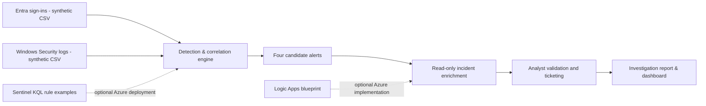

# SentinelSOC — Hybrid SOC Detection & Incident Triage Lab

> **Portfolio project for Shaik Omer Ahmed** | Target role: **SOC Analyst L2 / Security Operations Analyst / Microsoft Sentinel SOC Engineer**
>
> **LAB ONLY:** All log records, users, IP addresses, organizations and findings are synthetic. The offline demo runs locally and does **not** connect to Microsoft Azure, Microsoft Sentinel, Microsoft Defender, or any employer system. No real incidents were detected and no production automation was deployed.

## Why this project

This project demonstrates hands-on skills relevant to a SOC Analyst with experience in **Microsoft Sentinel, SIEM alert correlation, incident investigation, Azure security, Microsoft Defender, MITRE ATT&CK, detection tuning, and Azure Logic Apps**. It builds on the types of responsibilities described in the owner's resume without using confidential client information or implying the owner's employers were involved.

**Portfolio scenario:** An identity threat potentially affects a hybrid organization. A single source IP generates authentication failures across multiple accounts, then a successful sign-in. Separately, endpoint telemetry contains an encoded PowerShell command-line indicator and a Windows privileged-group membership addition. An analyst must correlate, classify, investigate, document and escalate the alerts.

## What you can demonstrate

| Workstream | Deliverable | Skill illustrated |
|---|---|---|
| SIEM / KQL | 5 Microsoft Sentinel query examples in `detections/kql/` | Sign-in correlation, Windows logs, workbook visualization |
| Detection engineering | Local Python analytics in `soc_lab/detections.py` | Rule thresholds, correlation, noise controls |
| MITRE ATT&CK | Rule catalog and technique mapping | T1110.003, T1078, T1059.001, T1098.007 |
| SOC operations | Synthetic investigation report and triage runbook | Incident lifecycle, evidence validation, escalation |
| SOAR | Logic Apps design blueprint | Safe incident enrichment, notifications and human approval |
| Quality assurance | Six built-in unit tests | Positive/negative detection tests |
| Reporting | Static browser dashboard and case study | Stakeholder communication, investigation results |
| GCC readiness | `docs/gcc_alignment.md` | Security-control intent for regulated employers, not compliance certification |

## Architecture



*Solid paths are implemented and runnable offline. Dashed paths are documented, optional Microsoft cloud integration designs and have not been deployed by this package.*

## Run in 2 minutes

Requirements: **Python 3.10+**; no pip packages, cloud account, or network access required.

```bash
python3 scripts/run_demo.py
python3 -m unittest discover -s tests -v
```

On Windows, use `py -3` instead of `python3` if needed.

The demo reads `data/signin_logs.csv` and `data/windows_events.csv`, generates four **candidate alerts**, and writes:

- `outputs/incidents.json` — machine-readable mock alerts
- `outputs/incident_report.md` — human-readable evidence notes and triage steps
- `dashboard/index.html` — open directly in a browser for an interactive, offline visualization

To rebuild the fixtures from scratch:

```bash
python3 scripts/build_fixture.py
python3 scripts/run_demo.py
python3 scripts/build_dashboard.py
```

These commands write only to local project files and make no network requests.

### Expected demonstration output

```text
SOC Lab — synthetic data only | no network calls
Read 20 sign-ins and 4 Windows event records
Found 4 candidate alerts (each requires human validation):
  Critical AUTH-002       Successful sign-in after password spray pattern
  High     AUTH-001       Multi-account password spray pattern
  High     IDENTITY-001   Account added to a security-enabled group
  Medium   ENDPOINT-001   Potentially suspicious PowerShell execution
```

## Detection logic and controls

1. **AUTH-001 — Password spray:** Ten or more failures across five or more user identities from one IP within a 30-minute sliding window. A negative-control user with six password errors does not trigger.
2. **AUTH-002 — Spray + subsequent success:** A source that met the spray threshold then successfully authenticates within 30 minutes of the detected spray window. This is **potential compromise only**, not proof.
3. **ENDPOINT-001 — Suspicious PowerShell:** Windows event 4688 contains PowerShell plus an encoded/decoding/download command-line indicator. Benign `Get-Date` is not flagged.
4. **IDENTITY-001 — Group membership change:** Windows event 4728/4732/4756 identifies membership addition. Actual risk depends on group sensitivity and approved changes.

**Important:** The Python engine uses event-by-event sliding windows; the KQL examples use fixed 30-minute bins. Production deployment should account for bin boundaries, ingestion delay, query costs, allowlists, role context, and duplicate alert suppression. There is no measured production false-positive rate or MTTD/MTTR improvement in this lab.

## Optional real Microsoft Sentinel implementation

See [`docs/azure_deployment.md`](docs/azure_deployment.md) for a guided checklist. This requires an Azure subscription, appropriate permissions, data connectors, and may incur charges. The example KQL has been reviewed against documented table fields, but was **not executed against a tenant** in this project. Run and tune each query in your own authorized lab before enabling an analytics rule.

See [`automation/logic_apps_blueprint.md`](automation/logic_apps_blueprint.md) for an analyst-approved, **non-destructive** incident enrichment workflow. It is a design specification, not a deployable Logic App JSON resource.

## Folder structure

```text
GCC_SOC_Sentinel_Portfolio/
├── README.md
├── data/                       # synthetic Entra/Windows records
├── detections/
│   ├── kql/                    # five Sentinel KQL examples
│   └── rules_catalog.csv
├── soc_lab/                    # local detection & reporting modules
├── scripts/                    # fixture, demo and dashboard scripts
├── tests/                      # unit tests and negative controls
├── outputs/                    # generated evidence notes and JSON
├── automation/                 # Logic Apps automation design
├── dashboard/                  # offline interactive demo
└── docs/                       # architecture, runbook, GCC, interview help
```

## How to present this in an interview

> “I created a **synthetic** hybrid-SOC investigation lab inspired by the Sentinel, Defender and incident response workflows in my professional experience. I built four detection scenarios using fake Entra/Windows logs, wrote five sample KQL queries, tested a local correlation pipeline, and documented how a human-in-the-loop Logic Apps playbook could route findings. The lab generated four alerts in its sample dataset and passed six automated tests. The Azure deployment is a design until I validate it in my own tenant.”

Use the precise resume/LinkedIn wording in [`docs/resume_linkedin_project.md`](docs/resume_linkedin_project.md). **Do not present the lab's sample alert counts as real employer performance metrics.**

## Safe use and attribution

- All IP addresses are documentation-only examples from `192.0.2.0/24`, `198.51.100.0/24`, and `203.0.113.0/24` (RFC 5737); accounts use `example.test`.
- No third-party data, customer identities, confidential assets, or privileged tokens are supplied.
- Rule outputs are investigation leads and require analyst judgment.
- No scripts execute PowerShell commands or alter accounts, firewalls, mailboxes or endpoints.

## References

- [SigninLogs table reference](https://learn.microsoft.com/en-us/azure/azure-monitor/reference/tables/signinlogs)
- [SecurityEvent table reference](https://learn.microsoft.com/en-us/azure/azure-monitor/reference/tables/securityevent)
- [Microsoft Sentinel scheduled analytics rules](https://learn.microsoft.com/en-us/azure/sentinel/scheduled-rules-overview)
- [Microsoft Sentinel automation rules](https://learn.microsoft.com/en-us/azure/sentinel/create-manage-use-automation-rules)
- [Microsoft Sentinel playbooks](https://learn.microsoft.com/en-us/azure/sentinel/automation/create-playbooks)
- [MITRE T1110.003](https://attack.mitre.org/techniques/T1110/003/), [T1059.001](https://attack.mitre.org/techniques/T1059/001/), [T1098.007](https://attack.mitre.org/techniques/T1098/007/)

_Last reviewed: 14 November 2026. Check current Microsoft portal workflows and subscription costs before cloud deployment._
