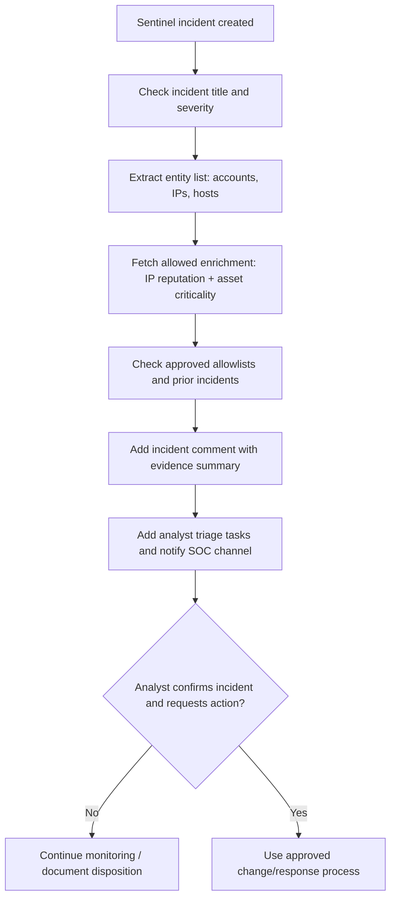

# SOAR project blueprint — Microsoft Sentinel + Azure Logic Apps

**Artifact type:** Implementation plan, not a deployed or deployable Logic Apps JSON template. **Human-in-the-loop by design.**

## Business scenario

An L2 SOC analyst receives a Microsoft Sentinel incident that may involve an Entra password spray followed by an account success. The response workflow should surface context quickly but **not** disable a user, revoke sessions, isolate endpoints, send mail externally or block an IP without explicit incident-commander approval.

## Proposed workflow

## Design details

| Element | Proposed configuration |
|---|---|
| Trigger | Microsoft Sentinel incident created; use connector appropriate to your Defender/Sentinel workspace |
| Filter | Incident is open and sourced from designated password-spray analytics rule |
| Inputs | Incident ID, title, severity, time, entities, owner, deep link |
| Deduplication | Record workflow execution ID as tag/comment; avoid repeat notifications for same incident state |
| Enrichment | Match IP/user/host to internal approved sources, documented reputation data, asset criticality |
| Actions | Add incident comment, create analyst tasks, notify internal incident channel |
| Approval gate | Assign human owner and require approval for disruptive containment |
| Auditing | Save execution timestamp, outcome, source and reason, actor and approval record |
| Secrets | Managed identities / Key Vault as supported; no credentials in source files |
| Failure handling | Retry transient API failures and route failed enrichment to human queue |

## Analyst tasks created by playbook

1. Confirm source IP, user, authentication failure codes and outcome.
2. Review sign-in risk, MFA/Conditional Access outcome and historical device context.
3. Correlate Defender XDR host evidence and Windows event timeline.
4. Decide true positive vs false positive with written rationale.
5. Propose approved containment and communicate impact to the incident lead.
6. Document remediation, closure code and lessons learned.

## Test plan for a future tenant deployment

- Trigger with a clearly labeled synthetic incident and confirm incident/entity parsing.
- Validate that automation creates a task/comment only once despite retry/re-execution.
- Confirm no authentication reset, IP block, asset isolation or other disruptive operation occurs automatically.
- Exercise missing entities, connector permission failure, enrichment timeout and notification failure.
- Confirm logging and RBAC fit the organization's policies.

See Microsoft's [automation rules](https://learn.microsoft.com/en-us/azure/sentinel/create-manage-use-automation-rules) and [playbook](https://learn.microsoft.com/en-us/azure/sentinel/automation/create-playbooks) docs for the current portal experience.
